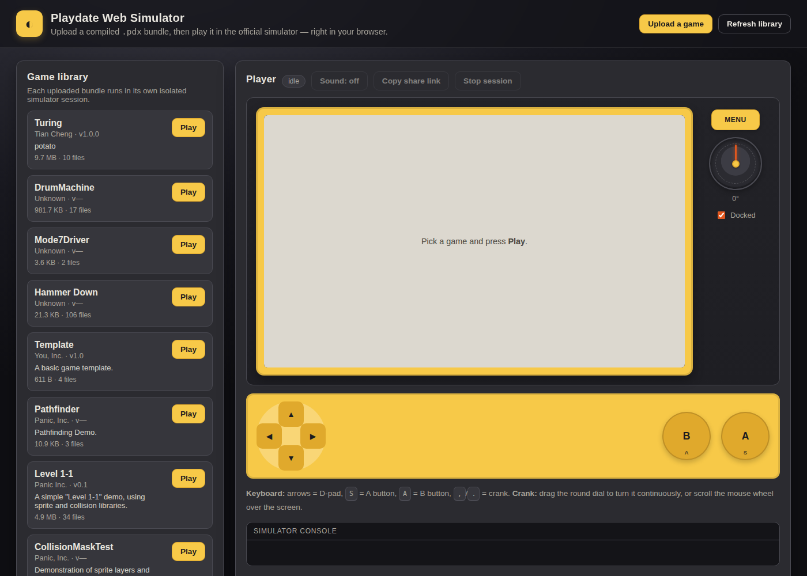
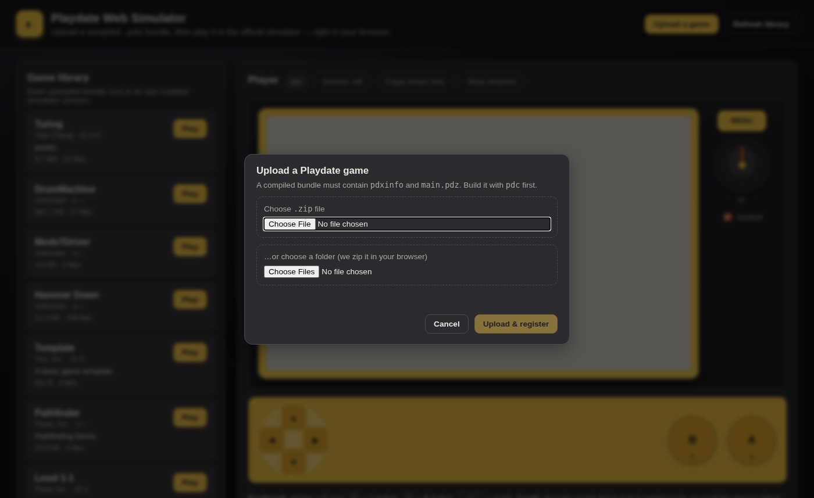
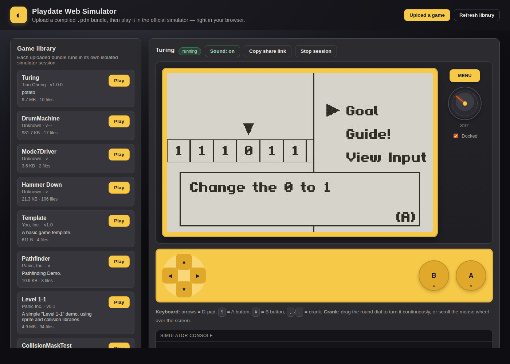
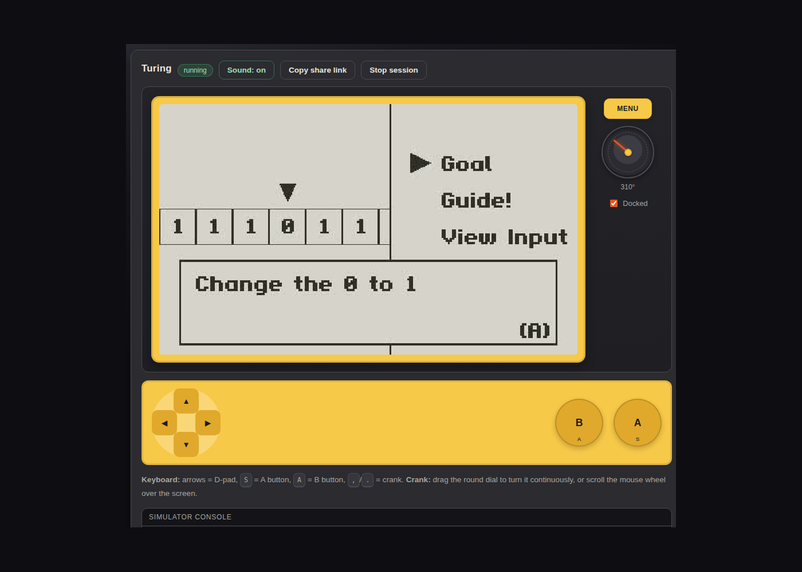

# Playdate Web Simulator

A small web application that lets a creator **upload a compiled Playdate `.pdx` bundle** and lets **other visitors play it in the official Playdate Simulator** — without installing the SDK or owning a Playdate.

The browser UI shows the real 400×240 device screen, a working D-pad / A / B controller, a continuously rotatable crank dial, the Menu button, and game audio. Input is sent to the simulator on the server, which streams its framebuffer back to the browser at ~30 fps (decoded on a `<canvas>` with stale-frame dropping) and its audio as a live MP3 stream.

**Runs on Linux and macOS.** On Linux it uses Xvfb + ffmpeg + xdotool (fully headless) and a private PulseAudio null sink per session for audio. On macOS it uses `screencapture` + `cliclick`/`osascript` (needs a logged-in GUI session); audio streaming is Linux-only. See [docs/DEPLOY-macOS.md](docs/DEPLOY-macOS.md) for the Mac mini deployment guide.

```
 upload .zip  ──►  storage/games/<id>/game.pdx
                          │
                          ▼
  Xvfb ──► PlaydateSimulator game.pdx ──► ffmpeg x11grab ──► MJPEG ──► browser canvas
                          │
                          └──► PulseAudio null sink ──► ffmpeg ──► MP3 ──► browser <audio>
                          ▲
                     xdotool input (keys / wheel / clicks)

  (macOS)     ──► PlaydateSimulator game.pdx ──► screencapture ──► JPEG ──► browser canvas
                          ▲
                     cliclick / osascript input
```

## Screenshots









## Why the real simulator, not a WASM build

The Playdate Simulator shipped in the SDK is a **proprietary, stripped ELF** built on GTK3 + WebKit. There is no source, and it links native GTK/WebKit libraries, so it cannot be compiled to WebAssembly with Emscripten. Two viable routes exist:

1. **Run the official simulator on a server and stream its screen** (implemented here). Highest fidelity: it *is* the official runtime, including Lua, C `pdex`, CoreLibs, audio, and sprite behaviour.
2. **Port an open-source emulator core to WASM** (not implemented; see [docs/WASM.md](docs/WASM.md)). Candidates: [Cranked](https://github.com/TheLogicMaster/Cranked) (MIT, WIP) and [Pyplaydate](https://github.com/alanstr-moreno/Pyplaydate) (MIT, Python HLE runtime that executes real `.pdx` Lua bytecode). Neither is feature-complete, and browser Lua bytecode support (Lua 5.4 with `LUA_32BITS`) needs work.

## Requirements

**Linux:**
- Linux x86_64 with `apt-get` available (for the X11 helper tools)
- Node.js ≥ 18 (no npm dependencies — pure standard library)
- The Playdate SDK (this repo is SDK 3.1.2), with `bin/PlaydateSimulator`, `bin/pdc`
- `ffmpeg` with `x11grab` and MP3 encoding support
- `unzip`/`zip`
- PulseAudio or PipeWire-Pulse plus `pactl` (`pulseaudio-utils`) for per-session game audio. Audio streaming is optional; set `AUDIO_ENABLED=0` to run without it.

**macOS (Apple Silicon / Intel):**
- macOS 13+ with a **logged-in GUI session** (the simulator is a native GUI app; no headless mode)
- Node.js ≥ 18 (`brew install node`)
- The Playdate SDK for macOS (download from https://play.date/dev/)
- `cliclick` for reliable input (`brew install cliclick`) — falls back to `osascript` keystrokes
- Built-in tools: `screencapture`, `sips`, `osascript` (no install needed)

## Setup

```bash
cd webapp

# Linux: extract Xvfb + xdotool into vendor/x11 without needing root
npm run setup:x11          # or bash scripts/setup-x11.sh

# macOS: check prerequisites and permissions
npm run setup:macos        # or bash scripts/setup-macos.sh

# Register SDK example games as playable content (optional but recommended)
npm run seed

# Start the server
npm run start              # http://127.0.0.1:4173
```

If the SDK lives elsewhere, set `PLAYDATE_SDK_PATH`. On macOS, if the simulator app is not at `bin/Playdate Simulator.app`, set `PLAYDATE_SIM_APP`. On Linux, if the X11 tools live elsewhere, set `X11_VENDOR_DIR`.

Environment knobs:

| Variable | Default | Meaning |
| --- | --- | --- |
| `PORT` | `4173` | HTTP port |
| `HOST` | `127.0.0.1` | Bind address |
| `PLAYDATE_SDK_PATH` | workspace root | SDK location |
| `PLAYDATE_SIM_APP` | `bin/Playdate Simulator.app` | macOS simulator bundle path |
| `X11_VENDOR_DIR` | `<workspace>/vendor/x11` | (Linux) Extracted Xvfb/xdotool |
| `MAX_UPLOAD_BYTES` | 64 MiB | Upload cap |
| `MAX_SESSIONS` | 3 | Concurrent simulator sessions |
| `SESSION_IDLE_MS` | 10 min | Idle session reaping |
| `AUDIO_ENABLED` | `1` | Set to `0` to disable session audio streaming |
| `AUDIO_BITRATE` | `96k` | MP3 bitrate for the browser audio stream |
| `PLAYDATE_VOLUME` | `200` | System volume seeded into `Disk/System/Data/global.settings` when it is missing or zero |

## Building a game to upload

A `.pdx` bundle must contain `pdxinfo` and `main.pdz`. Build it with `pdc`:

```bash
../bin/pdc -sdkpath .. Examples/FlippyFish/Source FlippyFish.pdx
zip -r FlippyFish.zip FlippyFish.pdx
```

Then upload `FlippyFish.zip` in the UI. Folder uploads are supported too: the browser packages the folder into a zip in-memory (no dependencies) and uploads it.

## API

| Method | Path | Purpose |
| --- | --- | --- |
| `GET` | `/api/games` | List registered games |
| `POST` | `/api/games?name=<file>` | Upload a zip (raw body, `application/octet-stream`) |
| `POST` | `/api/sessions` | Start a session: `{"gameId": "..."}` |
| `GET` | `/api/sessions` | List running sessions |
| `GET` | `/api/sessions/:id` | Session status |
| `DELETE` | `/api/sessions/:id` | Stop session |
| `GET` | `/api/sessions/:id/frames` | MJPEG stream (`multipart/x-mixed-replace`) |
| `GET` | `/api/sessions/:id/audio` | Live MP3 audio stream (`audio/mpeg`; Linux) |
| `POST` | `/api/sessions/:id/input` | Send input |
| `GET` | `/api/health` | Health check |

Input payloads:

```json
{"type":"button","button":"A","action":"down"}   // A/B/up/down/left/right
{"type":"button","button":"A","action":"up"}
{"type":"crank","delta":4.5}                     // degrees; fractional deltas accumulate
{"type":"dock","docked":true}                    // crank docked checkbox
{"type":"menu"}                                  // device MENU button
```

## Controls

- **Keyboard:** arrows = D-pad, `S` = Playdate **A**, `A` = Playdate **B** (the simulator's default mapping), `,`/`.` = crank
- **On-screen:** click/tap the D-pad and round A/B buttons
- **Crank:** drag the round dial continuously (the angle is unbounded, like a real crank), or scroll over the screen
- **Menu:** the MENU button on the right of the device; it is held briefly so the simulator registers the press
- **Sound:** the browser's sound button toggles the live game audio stream (Linux). Browsers may require one interaction before audible autoplay is allowed.

## Performance notes

- The browser reads the MJPEG stream with `fetch()`, parses JPEG frames itself, and draws the newest frame to a `<canvas>`. If decoding cannot keep up, intermediate frames are dropped instead of queuing up, so input-to-screen latency stays low. Browsers without streaming `fetch` fall back to a plain ``.
- Input commands are serialized on the server. A crank turn is sent as one batched `xdotool click --repeat` instead of one process per 4° notch, so a 360° flick completes in milliseconds rather than seconds.
- The virtual display is 900×820 (just large enough for the simulator window), and the framebuffer is captured at exactly 400×240 from the window's real origin, with no bezel included.
- Each session captures audio into its own PulseAudio null sink; the browser receives a 96 kbps MP3 stream.

## Security notes

- Uploads must be zip archives; entries with absolute paths, `..` traversal, or drive letters are rejected before extraction.
- Each session runs in its own `HOME` directory and its own PulseAudio null sink, seeded with `ShowElist=0` / `ShowPerfWarning=0` so the simulator starts clean.
- Sessions are isolated on separate virtual X displays and are capped/reaped by idle time.
- Uploaded games are untrusted code executed by the simulator process; run this service in a sandbox/container if you expose it publicly.

## Layout

```
webapp/
├── server/
│   ├── config.js      paths, limits, geometry, audio settings
│   ├── platform.js    shared subprocess/stream helpers, config seeding
│   ├── platform/      Linux (Xvfb/xdotool/audio) and macOS implementations
│   ├── ziputil.js     zip validation + extraction
│   ├── games.js       pdxinfo parsing, registration, library
│   ├── sessions.js    session lifecycle, serialized input, frame/audio fan-out
│   └── index.js       HTTP routes + MJPEG/MP3 streaming
├── public/
│   ├── index.html     UI
│   ├── app.js         upload, library, canvas player, audio, crank, input
│   ├── zip.js         dependency-free zip writer for folder uploads
│   ├── styles.css
│   └── favicon.svg
├── scripts/
│   ├── seed.js        compile SDK examples into the library
│   ├── setup-x11.sh   extract Xvfb/xdotool into vendor/x11
│   └── smoke-test.js  end-to-end API test
└── storage/           games/<id>/game.pdx, sessions/, tmp/
```

## License & SDK note

This app's own code is MIT-licensed. It does **not** redistribute the Playdate SDK: it invokes the SDK binaries already present in this checkout. The SDK itself is governed by `SDK_LICENSE.md`; users must obtain and comply with the SDK license separately.
